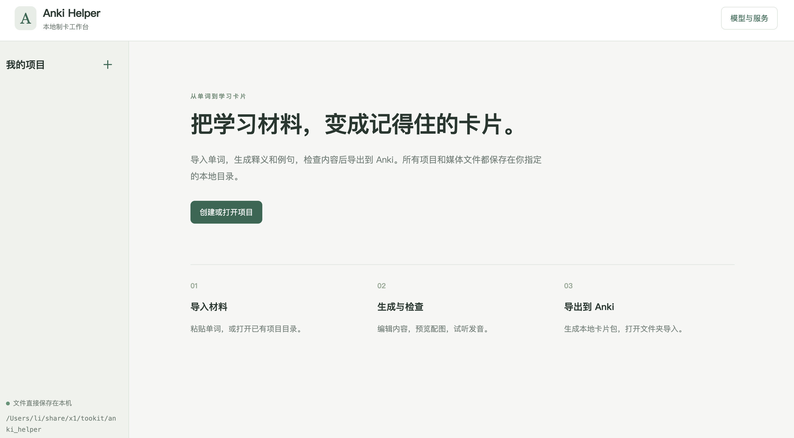

# Anki Helper

一个可独立运行的本地 Web 制卡应用，使用 Rust 后端和内嵌的 HTML/CSS/JavaScript。前端和默认 Anki 模板都在可执行文件中，用户无需安装 Rust、Node、Python、edge-tts 或 lame。

> [:us: English version](./README_en.md)



anki 卡片效果:


## 运行

下载与你的系统对应的可执行文件，放在一个可写目录中启动。无参数时启动本地 Web 应用，并自动打开浏览器：

```bash
./helper
```

Windows 可双击 `.exe`。Linux/macOS 首次使用可能需要 `chmod +x helper`；macOS 发行文件未签名时会受系统安全策略限制。配置和项目列表保存在**进程的当前工作目录**，终端启动时可以先 `cd` 到希望保存配置的目录。桌面启动方式的工作目录由系统决定，页面侧栏和启动输出会显示实际运行目录。

```bash
./helper serve --port 8765 --no-browser
```

默认端口为 `0`，自动选择空闲端口。服务只监听 `127.0.0.1`。不自动打开浏览器时，复制启动输出的完整地址（含 `#` 后的会话标识）打开。关闭浏览器不会停止应用，按终端中的 `Ctrl+C` 退出；重新启动后使用新的地址。一个运行目录同时只允许一个应用实例。

## 使用流程

1. 打开「模型与服务 → 服务连接」。页面仅提供火山引擎：方舟连接保存一份 API Key，文本、识图和配图共用；豆包语音使用独立的语音连接及 Key。页面固定提供方舟与豆包语音配置，无需添加连接；更改地址后需要重新填写 Key。已有多连接配置仍保留。
2. 在「模型用途」按文本、识图、配图、语音选择连接和模型。文本默认使用 DeepSeek V4.1 Flash，识图默认使用豆包 Seed 2.1 Lite，配图默认使用 Seedream 5.0 Flash。推荐列表不代表账号已开通；可填写自定义 Model ID / 接入点 ID，或在连接中维护模型列表。
3. 创建项目，默认名称为「英语单词」，目录为 `projects/英语单词`。修改名称会自动更新默认目录；手动修改目录后保留该路径。可以粘贴单词或读取 WordData JSON 数组。每行一个单词时可用 `Unit 2` 分组，页面不提供 TXT 文件上传。
4. 拍摄课本后面的课文单词表，上传 JPG、PNG 或 WebP 照片（最多 6 张，单张 8 MB，总大小 12 MB）。保存识图设置后点击「识别并填写单词列表」，模型提取英文单词、音标、中文释义和 Unit 分组，转换为 JSON。先检查识别结果，再创建项目或追加单词；识图不会直接写入项目，也不会生成例句。照片会发送给所选识图服务，可能产生费用。
5. 已有项目目录可以直接打开，读取 `word_json/*.json`，也支持从 `index.json` 初始化。项目中可追加单词，已有同名单词不覆盖。
6. 点击「补全全部缺失内容」。补全逐字段保留已有内容及手动修改，并显示文本、音频、配图状态。音频及图片默认关闭。启用音频后默认使用豆包语音，需配置语音 Key、资源 ID 和音色；macOS 可选择「系统语音」，调用系统自带的 `say` 生成 WAV，无需语音 Key，可填写系统已安装的音色名称。
7. 填写连接参数后可在对应服务下点击「验证此连接」，方舟生成示例文本、豆包生成示例语音，使用当前未保存的 Key 与参数，只验证该连接，其他连接尚未配置也不影响；也可在「模型用途」中单独验证文本、识图、配图和语音。验证不保存配置，修改设置后验证结果失效。识图测试使用内置 APPLE 图片，语音可试听，图片可预览。成功显示连接名称、模型及耗时，失败显示原因；修改参数后旧结果自动失效。测试使用当前设置并可能产生费用。临时测试媒体在退出后清理。卡片编辑区可单独重新生成文本、音频或配图；重新生成会提示替换与费用，任务失败后可以重试失败卡片。
8. 导出 Anki 卡片包。完成后页面显示完整本地文件路径，点击「打开所在文件夹」，在 Anki 中通过「文件 → 导入」选取 `.apkg`。也可导出 Markdown。豆包 MP3 和系统 WAV 都支持预览与打包。

项目数据保存在本机，调用模型时会发送相应单词、提示词、照片或朗读文本；macOS 系统语音在本机转换。补全会跳过已有媒体，切换模型、音色或音频方式后，需要主动重新生成才会替换已有文件。修改例句或配图描述会使对应媒体引用失效，下次补全时重建。单项音频或配图生成不要求配置文本 Key；媒体生成失败不会删除原有有效文件。

## 本地文件

运行目录保存：

```text
config.toml       # 配置（包含明文 API Key）
projects.json     # 项目名称和绝对目录路径
.helper.lock      # 防止同一运行目录重复启动的锁文件
projects/         # 未指定项目目录时的默认项目位置
```

每个项目目录保存：

```text
word_json/*.json  # 每张单词卡片的数据
recite_json/      # 原 CLI 支持的背诵数据（Web 暂无背诵编辑界面）
audio/*.mp3
images/*.png
.anki-deck-id     # 稳定牌组 ID，重复导出时保留
<目录名>_Deck.apkg
cards.md
```

导出任务在后台执行，分别显示卡片处理、数据库生成、媒体写入和收尾阶段。媒体按 64 KiB 分块写入 ZIP，进度按实际写入字节计算；MP3 和图片使用 ZIP 存储模式，避免重复压缩。最终文件先写到同目录临时文件，成功后替换目标文件，失败不会覆盖之前完整的卡片包。导出需要足够的本地磁盘空间，旧包和临时新包可能同时存在。

媒体预览及另存文件采用流式响应，不把整个卡片包加载到内存。下载不是必要步骤，最终文件已经保存在项目目录。重复导出使用稳定牌组及笔记标识；Anki 的实际更新行为仍取决于导入选项。

`config.toml` 首次启动自动创建。参考 [config.toml.example](config.toml.example)。旧版平铺配置会自动转换为连接配置，保存后 Key 仅存储在对应连接中。环境变量 `OPENAI_BASEURL`、`OPENAI_API_KEY`、`OPENAI_MODEL`、`ARK_API_KEY`、`TTS_API_KEY` 可在首次启动或迁移旧版配置时提供默认值；新的连接配置不会用环境变量自动恢复已清除的 Key。Unix 系统新写入的配置文件权限为 `0600`。设置页不会回显已保存 Key，同一连接与地址下留空保留，也可以明确清除。设置分为「服务连接」「模型用途」「高级」：连接页管理 Key 和地址，模型页按文本、识图、配图、语音切换，并直接测试当前用途的配置；端口和并发数位于高级设置。测试无需先保存，保存后配置应用于后续任务。

## 从源码构建与发布

```bash
cargo test --locked
cargo build --release --locked
```

前端交互测试使用 jsdom，可复用已有 Node 开发环境：

```bash
ANKI_JSDOM_PATH=/path/to/node_modules/jsdom node tests/web-ui.cjs
```

macOS 系统语音的实际生成与 Anki 导出测试需要系统语音服务：

```bash
cargo test --locked system_audio_generates_and_exports_without_cloud_credentials -- --ignored
```


构建产物为 `target/release/helper`（Windows 为 `helper.exe`），发布时只需要分发这个文件。应用内已包含 Web 资源及默认模板，HTTPS 使用 Rustls，SQLite 和 bzip2 编译进程序。Linux 跨发行版发布建议使用 musl 静态版本：

```bash
rustup target add x86_64-unknown-linux-musl
cargo build --release --locked --target x86_64-unknown-linux-musl
```

该目标需要系统安装 musl C 编译器，例如 Debian/Ubuntu 的 `musl-tools`。

[发布工作流](.github/workflows/release.yml) 可手动触发，生成 Linux x64（musl）、Windows x64、macOS Intel 和 Apple Silicon 的单文件产物。推送 `v*` 标签会在四个平台构建和测试通过后创建 GitHub Release。需要分别在各目标平台验证，工作流不包含应用签名或 macOS 公证。

## 保留的 CLI

```bash
./helper init /path/to/project --template /path/to/words.txt
./helper pack /path/to/project
./helper pack /path/to/project --template /path/to/custom-ankimodel.json
./helper md /path/to/project --output-dir /path/to/output
./helper pkg2md /path/to/file.apkg --output-dir /path/to/output
```

`pack` 默认使用内嵌模板，无需携带 `template/` 目录。`init` 使用与 Web 相同的配置和 HTTP 媒体服务。`pkg2md` 的字段映射针对本项目模板，并不适用于任意 Anki 模板。

模型建议列表基于 2026-10-08 的官方文档快照，账号实际可用性以设置页测试和控制台开通状态为准：

- [方舟模型公告](https://docs.volcengine.com/docs/ark/model-release-announcement?lang=zh)
- [Seedream 模型与参数](https://docs.volcengine.com/docs/ark/seedream-4-0-5-0?lang=zh)
- [豆包语音 HTTP V3](https://docs.volcengine.com/docs/DoubaoVoice/unidirectional-streaming-text-to-speech-http?lang=zh)
- [语音 API Key 使用](https://docs.volcengine.com/docs/DoubaoVoice/APIKeyUsage?lang=zh)
